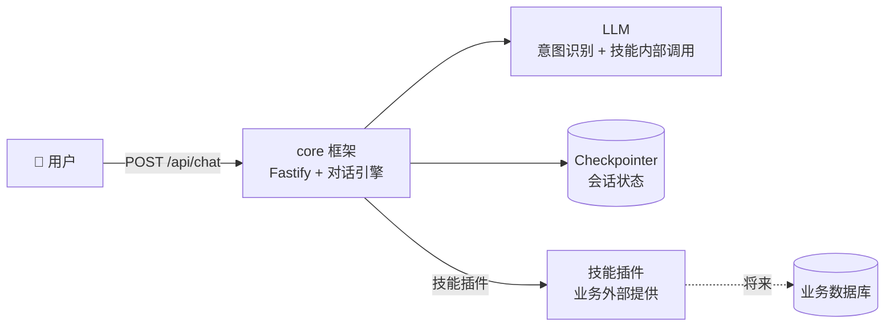
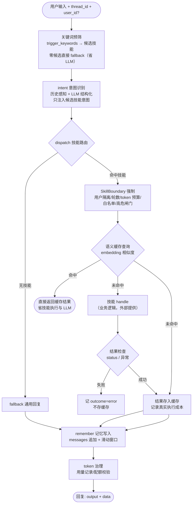
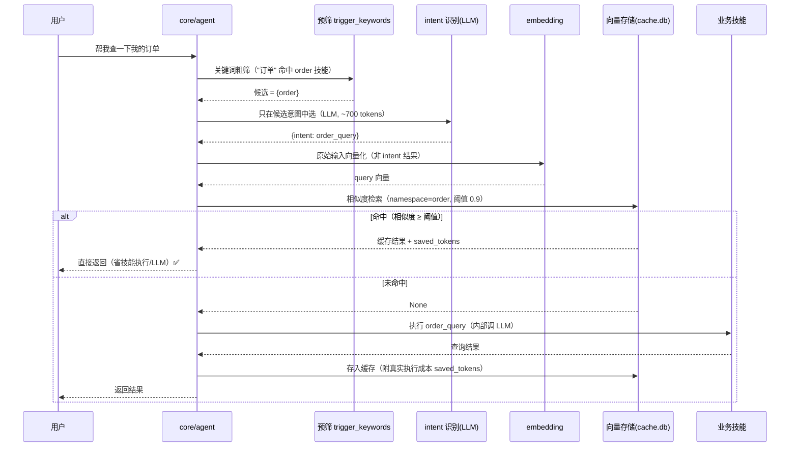

# 架构与流程图：Flyer 商城智能交互网关

> 配套文档：[产品需求 PRD](./PRD.md) ｜ [API 对接文档](./API.md)
> 本文档以 **Flyer（智能交互网关）** 为主线；业务能力以**技能（Skill）插件**形式接入。

## 1. 项目定位

```
Flyer（本项目的产品本体）
  = 商城智能交互网关：商城界面与业务系统之间的 Agent 编排层
    ├── 理解（意图识别/关键词预筛/历史感知）
    ├── 鉴权（JWT 用户断言：角色/技能白名单/数据域）
    ├── 编排（技能路由/多步执行/人工确认）
    ├── 执行（调业务系统 API，工具层）
    └── 反馈（结果契约/失败定位/任务轨迹/用量审计）
```

**一句话**：把商城界面（运营后台/前端）的自然语言请求，变成对业务系统的可信执行。
业务系统为外部系统（商城后端）；商城界面为交互入口。

## 2. 系统上下文图



## 3. 框架内部流程（core 对话引擎）



> 命中/未命中都会走 预筛 → intent 识别 → dispatch → 缓存查询；差异在缓存查询之后：
> 命中 = 直接返回（省 技能执行 + 技能内 LLM 调用）；未命中 = 执行技能并存缓存。

## 3.5 单轮请求时序（intent → 预筛 → 缓存 → 技能）

以"帮我查一下我的订单"为例（任意业务技能，如 order 技能）：



**要点**：
- 缓存查询向量化的是**用户原始输入**（`state.user_text`），不是 intent 识别出的结构化结果——换说法语义相近也能命中
- 缓存按 `namespace=技能 id` 隔离：不同技能的缓存互不串用
- 命中/未命中都要付 ① 预筛（零成本）② intent 识别 LLM（~700 tokens）；命中省的是技能执行 + 技能内 LLM（`saved_tokens` 记录的就是这段）

## 4. 模块与职责（core 全貌）

| 模块 | 职责 | 状态 |
|---|---|---|
| `src/core/agent.ts` | 对话引擎：intent→dispatch→remember 三节点 + interrupt + 交互接口（LangGraph JS） | ✅ 已实现 |
| `src/core/intent.ts` | 意图识别：LLM 结构化输出 + 规则兜底（历史感知）+ 关键词预筛（trigger_keywords 缩小注入清单） | ✅ 已实现 |
| `src/core/registry.ts` | 技能注册表：意图→技能映射；Skill 基类 | ✅ 已实现 |
| `src/core/skills_loader.ts` | 技能包机制：扫描 skills/ 自动注册 + skill.yaml manifest 解析（仓库即规范） | ✅ 已实现 |
| `src/core/config.ts` | 框架配置（.env，pydantic→TS 手写） | ✅ 已实现 |
| `src/core/usage.ts` | token 用量记录 + 缓存命中审计（memory/sqlite） | ✅ 已实现 |
| `src/core/cache.ts` | 语义缓存（可插拔 embedding：ollama/cloud；向量存储 memory/sqlite；仅成功结果入缓存） | ✅ 已实现 |
| `src/core/security.ts` | JWT 断言鉴权（jose RS256）→ UserContext（角色/技能白名单/数据域） | ✅ 已实现 |
| `src/core/embedding.ts` | embedding 层（ollama/cloud 可插拔） | ✅ 已实现 |
| `src/core/log.ts` | JSON 日志 | ✅ 已实现 |
| `src/types/index.ts` | GenericState / SkillResult（zod）/ SkillManifest / UserContext | ✅ 已实现 |
| `src/api/server.ts` | Fastify API：/health /api/chat /api/resume /api/usage，jwt/api_key/none 鉴权 | ✅ 已实现 |

## 5. 设计原则（决策记录）

### 原则 A：core/skills 分离
- core 无业务痕迹：只认识 意图/消息/技能接口，不认识"商品/客服"
- skills 是测试载体：任何业务场景 = 新技能（Skill 子类 + manifest + 注册），core 零改动

### 原则 B：多轮对话 = 滑动窗口 + 状态压缩
- messages 滑动窗口（`CONTEXT_WINDOW_ROUNDS`，默认 6）控输入成本
- 关键状态存 `data` 命名空间（结论压缩），不随窗口丢失
- 意图识别历史感知（"换黑色的"承接上文）

### 原则 C：状态存储（崩溃恢复）
- `CHECKPOINTER=memory|sqlite`（sqlite 落盘，重启可恢复）
- 生产多副本换 PostgresSaver（改 `core/memory.py` 一处）

### 原则 D：可观测性
- JSON 日志 + request_id 贯穿；LLM 调用日志（fn/耗时/token）；降级告警 + 通知器

### 原则 E：确定性归确定性
- 检索过滤/预算解析/配额校验：确定性规则，不调 LLM（零成本零幻觉）

### 原则 F：技能间隔离
- 技能互不感知（各自 manifest + data 命名空间）；多插件共存由测试保障

### 原则 G：横切能力框架化（token/权限/日志同层）
- **token 治理、权限、日志都是横切关注点**：技能无感、框架自动
- 技能只做**声明**（manifest：session_mode/资源策略），core 做**强制**（记录/校验/拦截）

## 6. Token 治理设计（核心设计，以 token 处理为核心）

### 6.1 问题定义
- token 成本 = 输入×单价 + 输出×单价，**随调用线性增长**
- 多轮下输入 token **复利式膨胀**（每次带上全部历史）→ 输入是大头
- 需要解决两个问题：**① 用量记录 ② 用量控制**

### 6.2 用量记录（core 职责，度量层）
- **必须**：度量是控制的前提
- **已实现（core/usage.py）**：
  - 粒度：按 **会话（thread_id）** + **技能（manifest.id）** 拆分 ✅
  - 存储：`USAGE_STORE=memory|sqlite`（sqlite 落盘 usage_events 表，重启保留，可聚合查询）✅
  - 出口：每次调用落 JSON 日志事件（usage_event：thread/技能/输入输出 token）✅

### 6.3 用量控制（分层，每层归不同主体）

```
层1 单次控制（core 内置）✅
    ├─ max_tokens：输出上限（保险丝，待加）
    └─ 滑动窗口：输入封顶（已有）

层2 会话控制（core 强制）⬜ 规划
    ├─ max_turns_per_thread：会话轮数上限
    └─ token_budget_per_thread：会话 token 配额
    超限 → 拒绝/告警（不靠技能自觉）

层3 技能策略（core 提供机制，技能声明）⬜ 规划
    ├─ session_mode（single/multi）
    └─ max_llm_calls_per_turn
    manifest 声明 → core 运行时校验

层4 缓存（core 通用能力）⬜ 规划
    └─ 语义缓存：相同/相似输入直接返回缓存结果，不调 LLM
    （上下文缓存是模型侧特性，改配置即可，非框架职责）
```

### 6.4 五个候选方案裁决（以 token 为核心判断）

| 方案 | 裁决 | 理由 |
|---|---|---|
| 结论状态压缩 | ✅ **已实现**（data 命名空间） | 输入侧省钱的根：模型不重读过程 |
| 单次会话模式 | ✅ **机制入框架**（session_mode），决策在技能 | 消灭输入膨胀最彻底；但"是否单次"是技能业务决策 |
| 缓存命中 | ✅ **值得做**（语义缓存） | 重复问题不调 LLM，输入/输出双省，所有技能受益 |
| 历史摘要 | ⏸️ 预留接口，暂不实现 | 窗口已控成本；摘要是"保质量"非成本必需 |
| 向量检索历史 | ⏸️ 预留，更后置 | 复杂度最高；同为质量手段，与摘要二选一演进 |

**裁决逻辑**：先解决**成本失控（硬伤，烧钱）**，再解决**信息丢失（软伤，体验）**——记录/窗口/max_tokens/配额/session_mode/语义缓存进 core；摘要/向量留接口后置。

### 6.5 实施优先级

```
P0（✅ 已实现）：用量记录升级为会话/技能级（memory/sqlite）+ max_tokens
P1（✅ 已实现）：语义缓存（可插拔 embedding）+ 会话级配额（轮数/token 预算）
P2（✅ 已实现）：manifest 加 session_mode/max_llm_calls/data_scopes/tools/闸门 + core 校验
P3（⬜ 预留）：摘要/向量检索接口（等"窗口丢信息"成真实痛点）
```

## 7. 技能资源与安全边界（SkillBoundary，token 治理 + 权限的合一）✅ 已实现

### 7.1 定位
> 技能通过**一个 manifest 声明**"资源预算 + 数据边界 + 操作闸门"；core 在运行时**强制执行**（不靠技能自觉）。
> 这是 token 治理（能花多少）与权限（能碰什么/什么要批准）的统一——"资源+安全边界"三合一。
> 差异化论证：LangGraph 只有 interrupt（闸门的一个零件），无预算/白名单/配额体系；单独做配额或白名单会被"自己写个装饰器"替代，三合一才是完整心智模型。

### 7.2 Manifest 扩展设计

```python
class SkillManifest(BaseModel):
    # ---- 现有（能力声明）----
    id: str
    name: str
    description: str
    intents: list[str]

    # ===== 新增：资源与安全边界 =====

    # --- 会话形态 / 资源消耗 ---
    session_mode: str = "single"              # single=单次（省资源）/ multi=多轮
    max_turns_per_session: int = 1            # 单会话最大轮数（single 默认 1）
    max_llm_calls_per_turn: int = 5           # 每轮最大 LLM 调用数（防失控循环）
    token_budget_per_session: int = 0         # 会话 token 预算（0=不限制）

    # --- 数据 / 工具边界（最小权限）---
    data_scopes: list[str] = []               # 可访问的数据域（如 ["products", "users"]）
    tools: list[str] = []                     # 可调用工具白名单

    # --- 操作闸门 ---
    requires_confirmation: bool = False       # 是否涉及高危操作（下单/删除/发送）
    confirmation_after: int = 0               # 前 N 次调用免确认，之后需确认
```

### 7.3 三个维度的执行语义（core 强制）

```
资源消耗（token 治理）：
  会话开始：读 manifest → 建立配额上下文（budget/turns 计数）
  每轮开始：check turns < max_turns_per_session？ 超了 → 拒绝 + "本次会话已结束"
  每次 LLM 调用：check calls < max_llm_calls_per_turn？ 超了 → 截断 + 降级规则
  每轮结束：累计 token → check < token_budget？ 超了 → 告警 + 拒绝后续

数据/工具边界（权限）：
  技能调用工具前经过 core 拦截器：
    check 工具 ∈ tools 白名单？   不在 → 拦截 + 日志 + 告警
    check 数据域 ∈ data_scopes？  不在 → 拦截（查询层加作用域校验）

操作闸门（高危）：
  requires_confirmation=True？
    是 → interrupt（等人工确认）→ 确认放行 / 拒绝回滚
    可用 confirmation_after 做"前 N 次免确认"（低频风险场景）
```

### 7.4 示例声明

```python
# 技能声明边界示例（业务技能外部提供，框架按此强制）
SkillManifest(
    id="any_business_skill", name="业务技能", description="职责说明",
    intents=["..."],
    session_mode="single|multi",      # 会话形态（资源维度）
    max_turns_per_session=..., max_llm_calls_per_turn=...,
    token_budget_per_session=...,     # 资源配额
    data_scopes=["..."], tools=["..."],   # 数据/工具白名单
    requires_confirmation=False,      # 高危操作闸门
)
```

### 7.5 与现有架构的挂载点

| 边界维度 | 挂载点 | 现有基础 |
|---|---|---|
| 会话/轮数/预算 | `core/limits.py`（规划） | dispatch/remember 节点处 |
| LLM 调用数 | `core/llm.py` UsageCollector | 已收集调用数，加配额校验即可 |
| 数据/工具白名单 | `core/registry.py` + 工具层 | manifest 已有 intents（能力白名单雏形） |
| 操作闸门 | 技能内部 interrupt | **已实现**（clarify/approve） |
| 用量记录 | `core/usage.py`（memory/sqlite + JSON 日志事件） | ✅ 已实现 |
| 审计报表 | `GET /api/usage`（按技能/会话汇总） | ✅ 已实现 |

### 7.6 落地路径

```
M3-P0：用量记录升级 + max_tokens              ← 度量基础
M3-P1：语义缓存 + 会话配额（turns/token 预算）  ← 资源维度
M3-P2：session_mode + max_llm_calls_per_turn  ← 技能策略
M4：  API 鉴权 → 白名单（data_scopes/tools）→ 拦截器 → 审计  ← 权限维度
最终：三合一 manifest（本文档）成型
```

**原则**：分阶段实现，但 manifest 字段从一开始预留（不破坏兼容），每步都是"加字段 + 加校验"，不重构。

## 8. 演进预留（不实现，留接口）

| 预留项 | 触发条件 | 落地方式 |
|---|---|---|
| 子 Agent/子图 | 技能内部分工需要并行/独立循环 | 技能内部建 LangGraph 子图（core 零改动） |
| 跨会话长期记忆 | 需要用户画像/全局知识 | LangGraph Store（InMemoryStore→PostgresStore），挂 `compile(store=)` |
| 历史摘要/向量 | 窗口丢信息成真实痛点 | core/context.py 预留接口 |

## 9. 技能插件（业务外部提供）

- 技能为**外部插件**（Skill 子类 + manifest + 注册），core 只提供机制
- 业务技能由外部按需提供（Skill 插件机制）；测试用 core 内置测试技能（tests/test_core.py）+ 临时技能包（tests/test_skills_loader.py）
